# Replacement Firmware for the Aeris Aair 3-in-1 Pro Air Purifier

This guide will walk you through flashing a new firmware onto the Aeris Aair 3-in-1 Pro Air Purifier, which will enable local control of the device over MQTT, which can then be added and controlled via Home Assistant. It also allows some small customization of the appearance of the top display.

<table>
  <tr>
    <td valign="middle">
      
    </td>
    <td valign="middle">
      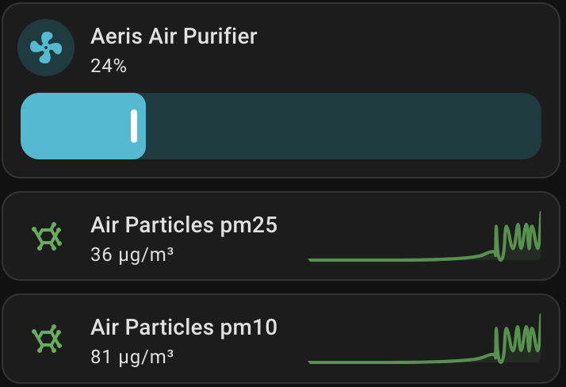
    </td>
  </tr>
</table>

<br>
<br>

## Disclaimer

The steps below are not complicated to do but make sure you read through everything before committing. The unit adjusts its fan speed to air quality on its own in the auto modes (see [Auto Modes](#auto-modes)), and everything can also be controlled over MQTT, for example from Home Assistant.

<br>
<br>

## Software Needed:

The guide below and the software linked to here are for flashing from Windows. If using Mac or Linux then after getting access to the board navigate down to Mac / Linux section.

1.  [Zadig](<https://zadig.akeo.ie/>)

2.  [dfu-util v0.9](<http://dfu-util.sourceforge.net/releases/dfu-util-0.9-win64.zip>)

3.  [Particle CLI](<https://binaries.particle.io/cli/installer/windows/ParticleCLISetup.exe>)

4.  [Free Particle CLI Account](<https://login.particle.io/signup>)

5.  [Particle Bootloader update](<https://github.com/particle-iot/device-os/releases/download/v3.3.1/photon-bootloader%403.3.1%2Blto.bin>) — the v3 firmware needs Device OS **3.3.1 or newer** (system module version 3302; 3.3.0 is 3301 and is not enough).

6.  [Replacement Software Binary](https://github.com/mjaymeyer/aeris-aair-home-assistant/releases) (unless building from source)

<br>
<br>

## Teardown/Accessing Board

1.  Unplug unit, remove top cover and flip over

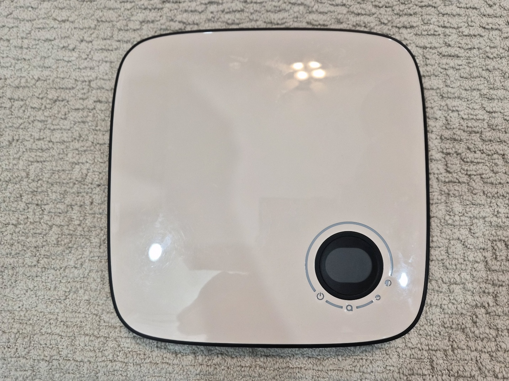

3.  Remove the eight short screws, carefully lift out the inner-part of
    the case bottom to top to not damage the wires upper-left

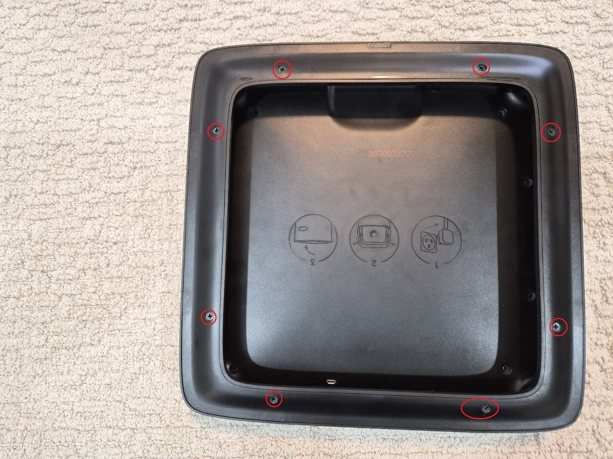

3.  Remove the four silver screws, again carefully lift the outer
    bracket bottom to top to not damage the wires

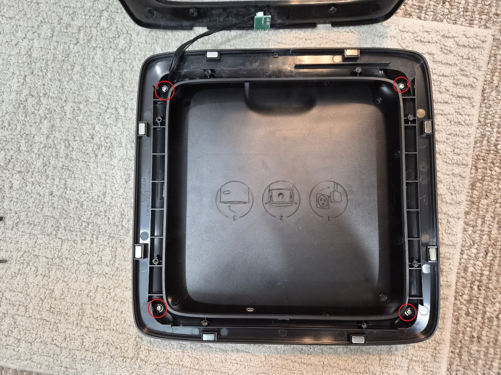

4.  Remove the 12 slightly longer screws. Carefully pull the plastic
    cover bottom to top to reveal the main board.

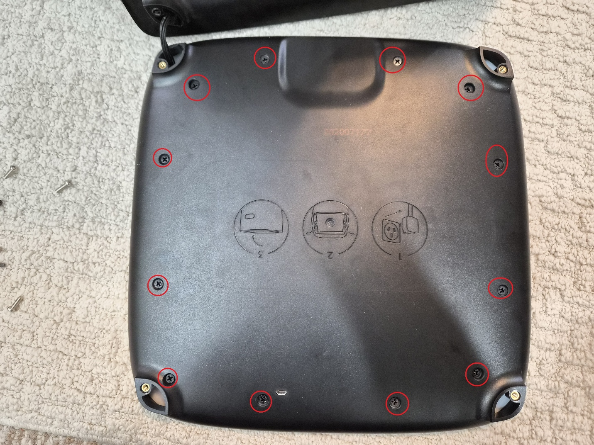

5.  Carefully pull off the wire connector to separate the main board
    from the body entirely. No need to unscrew the board from the white
    plastic backing.

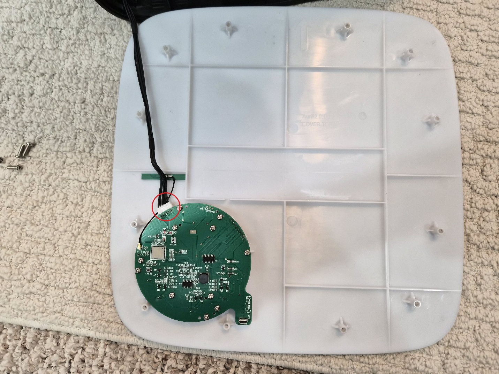

6.  For the flashing process we will use the two buttons 'RESET' and
    'SETUP' that should be pretty easy to work with.

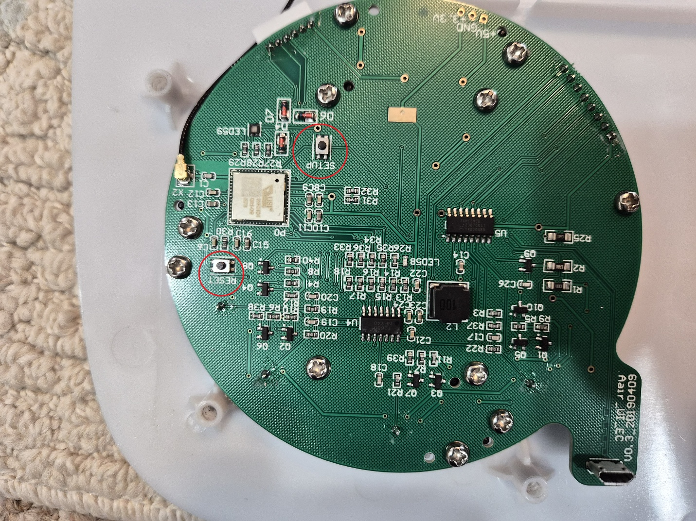

## Flashing Replacement Software

The below shows the steps to flash from a Windows machine. If you're
using Mac or Linux it shouldn't be too hard to obtain the relevant
versions and follow along.

### Initial Connection, Driver Install

1.  Extract dfu-util to a folder. I've used C:\\DFU (no subfolders, you
    should be able to execute C:\\DFU\\dfu-util.exe)

2.  Attach the micro-usb cable to the unit, two LEDs should come on

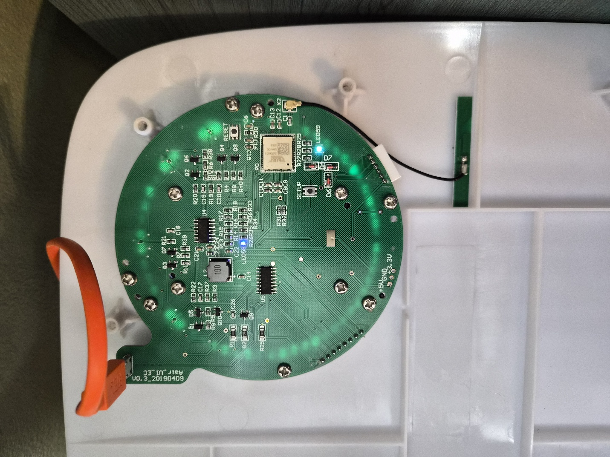

3.  Put the device in DFU mode by pressing both the RESET
    and SETUP buttons. Immediately let go of RESET but continue holding
    SETUP for 3 seconds. LED59 (to the right of the
    setup button) should start flashing yellow, you are in DFU mode and
    you can let go of the SETUP button.

4.  Launch Zadig

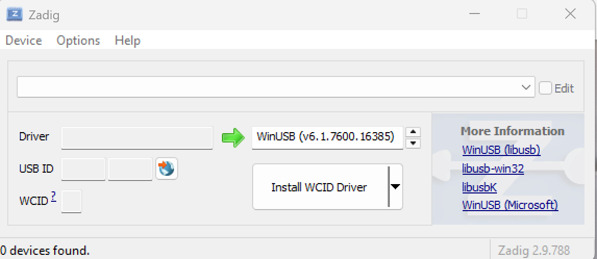

5.  Go to Options and check 'List All Devices'

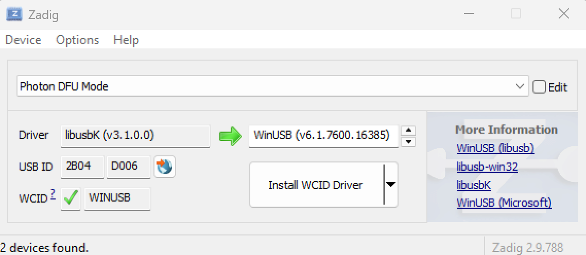

6.  Select Photon DFU Mode in the dropdown (if you do not see it try
    unplugging the micro-usb cable, waiting a few, then plugging it back
    in and putting the device back in DFU mode again).

7.  Note the USB ID listed (2B04:D006). We will reference this in later
    steps so take note if yours is different and adjust accordingly.

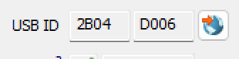

8.  Select libusbK (v3.1.0.0) on the right using the down arrows (note
    that I already installed the driver on my device so it matches the
    driver listed on the left, yours likely will not). Click 'Replace
    Driver' and wait for it to install. Once installed you can close
    Zadig.

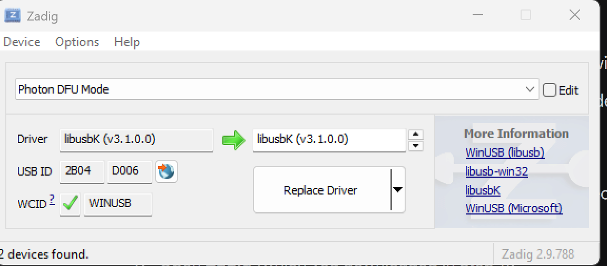

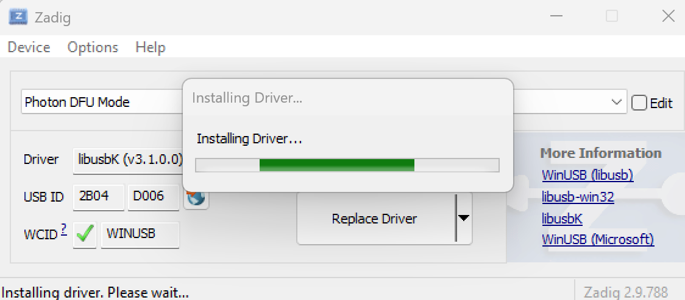

### Taking a Backup

First we'll make a backup of the original software.

1.  Open an admin-level command prompt and navigate to the folder you
    extracted dfu-utils to.

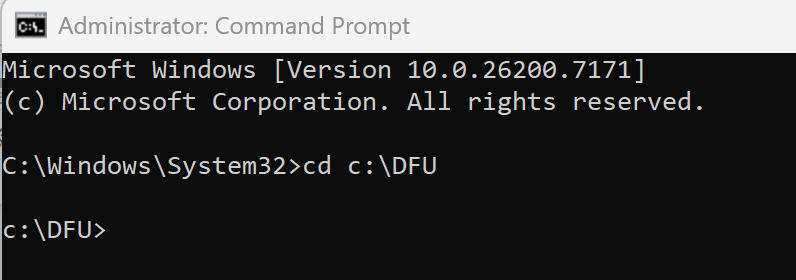

2.  Execute the following command to backup the firmware, adjusting the
    device ID if necessary.

```dfu-util.exe -d 2b04:d006 -a 0 -s 0x08020000:0xE0000 -U original_firmware.bin```
>
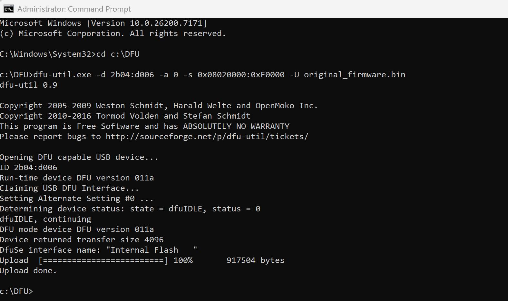

3.  This should export original_firmware.bin (despite it saying Upload)
    to the same directory you put dfu-util in. Backup the .bin to a safe
    place.

### Updating the Bootloader and Base Particle System

You will likely need to update the bootloader of the device to flash the
new software to it. It's possible there are some units out there with a
later bootloader but given the software support of Aeris, I doubt it. I
don't recall ever receiving a firmware update on my device from the
manufacturer.

#### Updating Bootloader

1.  Download the bootloader if you have not already, rename it
    to bootloader.bin to make it easier. I placed it in the same DFU
    folder to keep things simple.

2.  Install Particle CLI if you have not already. Test that you can
    execute it from command prompt (you may have to open a new Window if
    you just installed it)

```particle version```
>
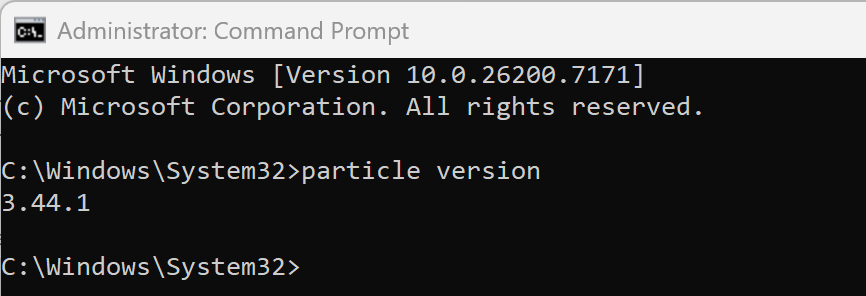

3.  Run the below command to flash the bootloader

```particle flash --local C:\DFU\bootloader.bin```
>
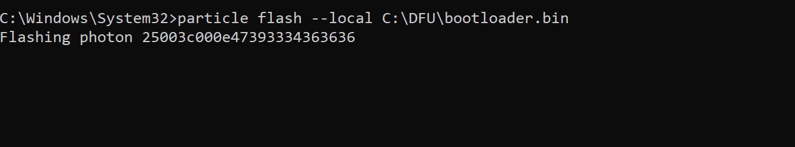

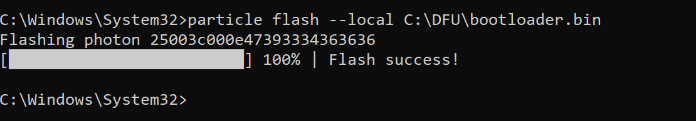

#### Updating the Particle software

1.  To get the latest system version from particle we need to login.
    Enter the below command followed by your email and password you
    setup when you created an account on particle.io

```particle login```

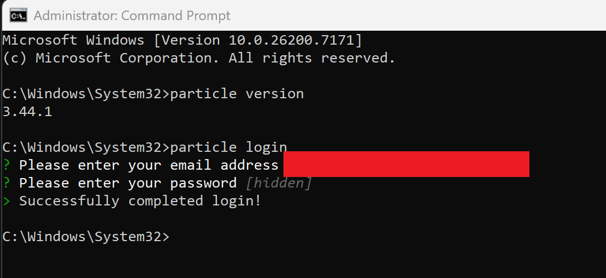

2.  To update the bootloader and base system simply enter the below.

```particle update```

3.  Check the result with `particle serial inspect` (device in normal mode, not DFU). The v3 firmware depends on **system part 2 version 3302 or newer (Device OS 3.3.1+)**. My unit (2020 production) shipped with Device OS 0.5.0 (version 21); later production runs may be newer. Device OS 3.3.0 reports 3301, which is *not* enough — the app will not start (status LED blinks blue, no display, no `Aeris-xxxx` network).

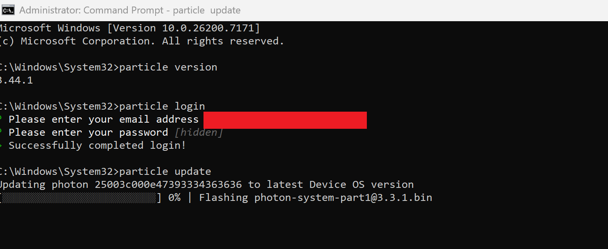

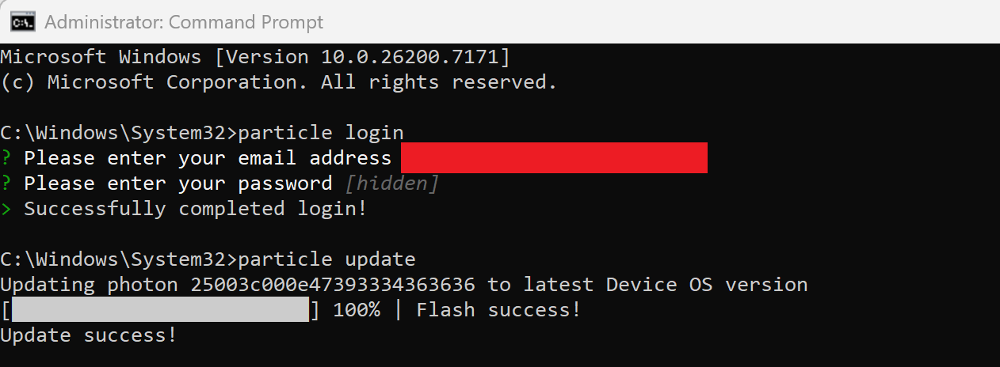

NOTE: Your device may seem to freeze (like below) when it gets to "Switching device to normal mode", if it says it fails after this do not panic, it is likely fine. You likely don't need to update again but are welcome to put your device back in DFU mode and try it again if you'd like, though I don't believe anything else needs updated. My device would seemingly fail after the switch back to normal mode but the software was definitely good to go regardless.

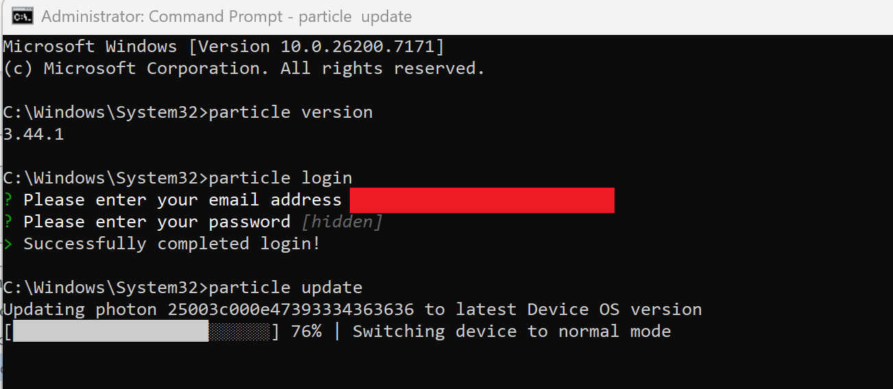

### Mac / Linux: offline flashing (no Particle account)

Tested on macOS with dfu-util 0.11 and Particle CLI 3.50 (`npm install particle-cli`). No Zadig or driver step is needed.
Do **not** just run `particle flash --local aerisFirmware.bin` on a stock unit: on an early unit still running Device OS 0.5.0
(mine is from 2020) it writes only the application and leaves the system firmware untouched, so the unit ends up with a blue blinking LED, a dark display and
no `Aeris-xxxx` network. Write the Device OS system parts explicitly instead.

1.  Download from the [Device OS 3.3.1 release](https://github.com/particle-iot/device-os/releases/tag/v3.3.1):
    `photon-system-part1@3.3.1.bin`, `photon-system-part2@3.3.1.bin`, `photon-bootloader@3.3.1+lto.bin`.

2.  Put the unit in DFU mode (blinking yellow) and take the backup as described above:

```dfu-util -d 2b04:d006 -a 0 -s 0x08020000:0xE0000 -U original_firmware.bin```

3.  Still in DFU mode, write the two system parts and then the application (`:leave` reboots the unit):

```
dfu-util -d 2b04:d006 -a 0 -s 0x08020000 -D photon-system-part1@3.3.1.bin
dfu-util -d 2b04:d006 -a 0 -s 0x08060000 -D photon-system-part2@3.3.1.bin
dfu-util -d 2b04:d006 -a 0 -s 0x080A0000:leave -D aerisFirmware.bin
```

4.  Once the unit is back in normal mode (`particle usb list` shows it as `Photon`), update the bootloader:

```particle flash --local photon-bootloader@3.3.1+lto.bin```

5.  Verify: `particle serial inspect` should show bootloader 1100, system parts 3302 / 3302 and user part 6.
    The display then shows the setup screen described below.

## Flashing the compiled binary

1.  Download the Release aerisFirmware.bin if you have not
    already, I placed it in the same folder as I put dfu-util. Put your
    device back into DFU mode if it is not.

2.  In CMD make sure you are back in the same folder where you have
    dfu-util.

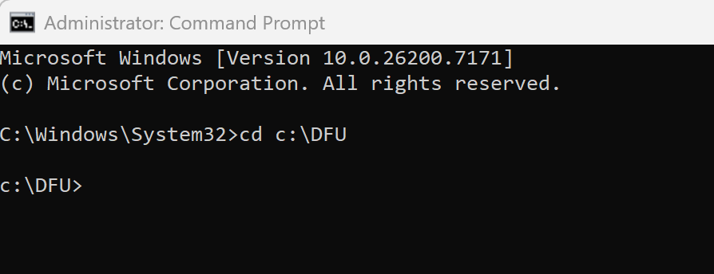

3.  Simply run the below command to flash the new software, it should
    install very quickly.

```dfu-util.exe -d 2b04:d006 -a 0 -s 0x080A0000:leave -D aerisFirmware.bin```
>
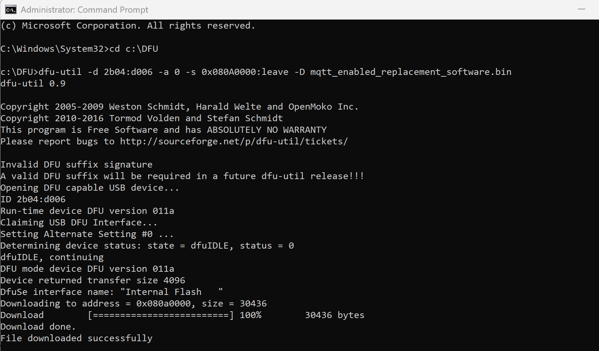

4.  Assuming it flashed if you look on the front panel you should see
    the following setup screen

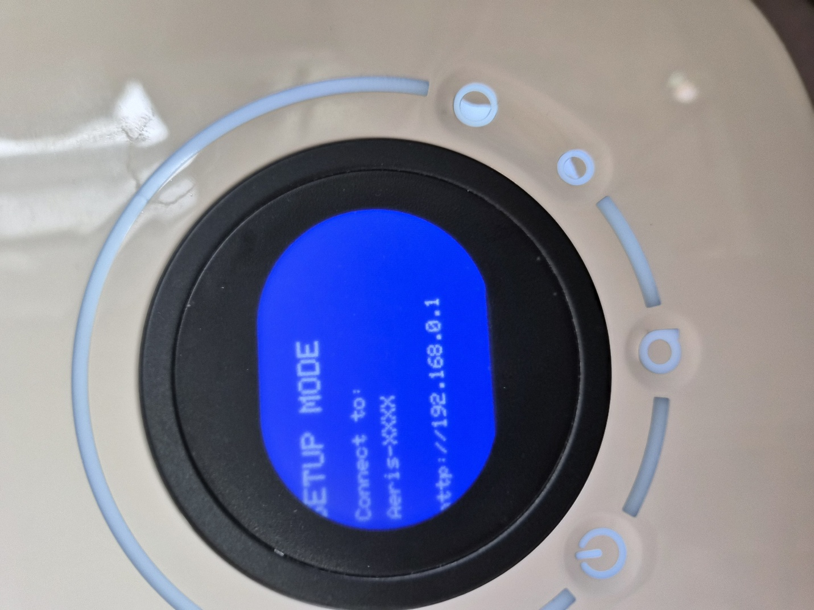

At this point you can unplug the USB and put back together your air
purifier, though you can run through the below first if you'd like.

## Setup Process

It is highly recommended to set the device up from a laptop as it is
much easier than fighting with a phone.

Alternatively, while the unit is still on USB, [tools/usb-setup](tools/usb-setup/README.md)
writes the Wi-Fi and MQTT settings directly, skipping both stages below.
It can also update the firmware later without losing the settings.

### Stage One (WiFi Network Connecting)

1.  An unencrypted WiFi network named Aeris-xxxx should be broadcasting.
    Connect to it and in a web browser navigate to <http://192.168.0.1>

2.  Enter your WiFi network credentials and click CONNECT, the device
    should restart.

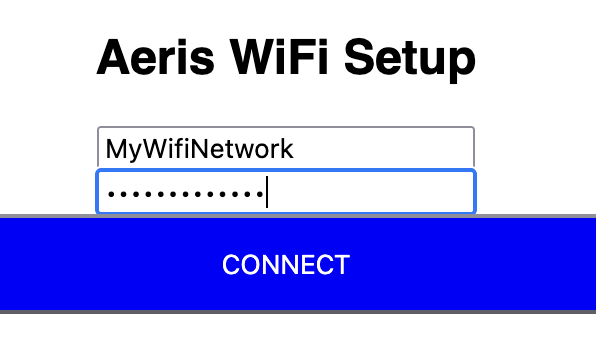

3.  Assuming you entered valid credentials you should see the unit
    display OFF and the buttons should function.
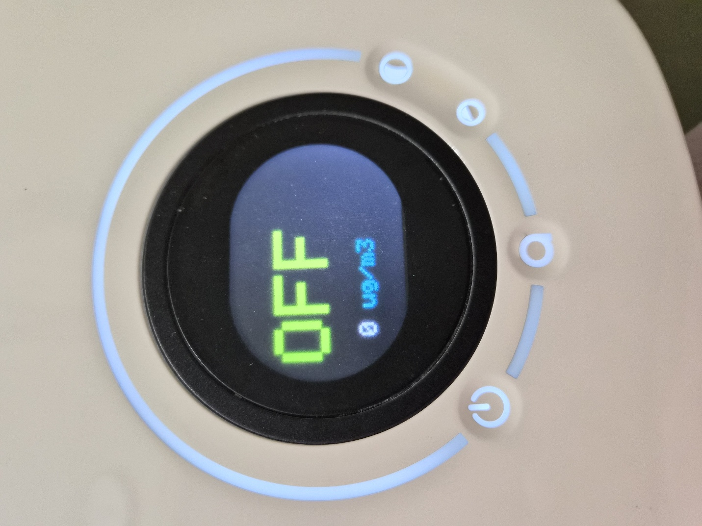

### Stage Two (MQTT and Display Customization)

1.  In a web browser now navigate to the true IP of the air purifier on
    your network (such as http://192.168.0.32). If it doesn't load confirm that you are hitting the right device and that you are not using https://, you should get the below page.

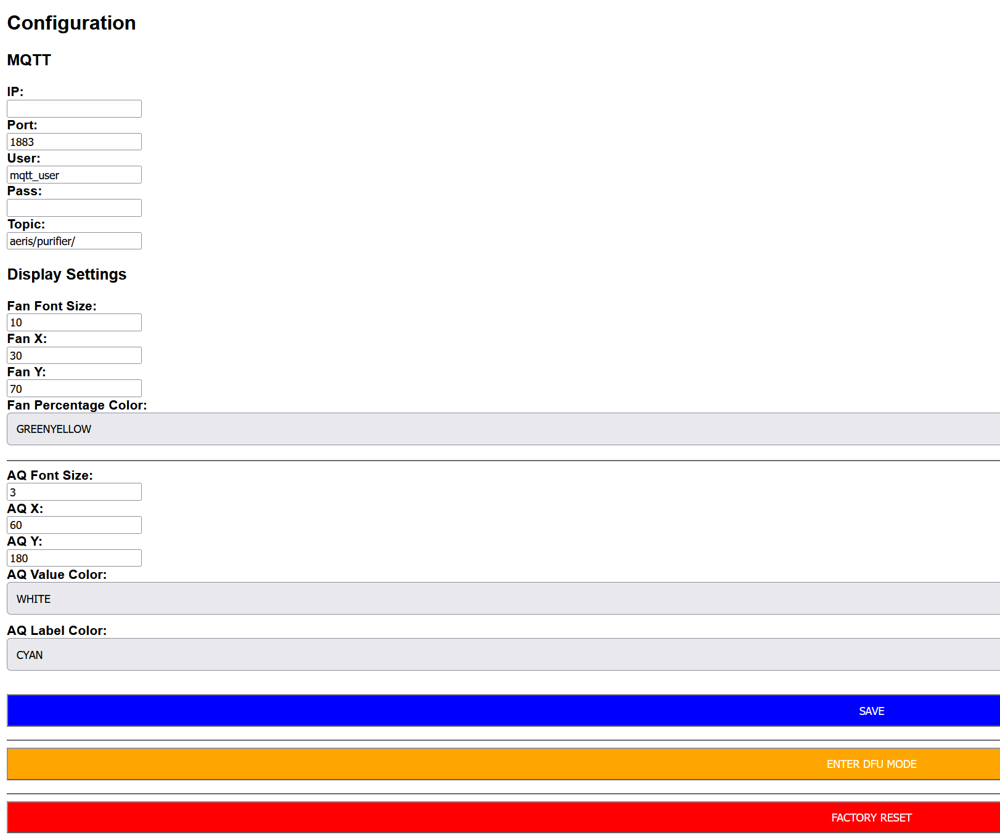

2.  The display settings are already configured though you can of course
    adjust them to achieve a different look. In the top MQTT section
    enter your MQTT broker IP (e.g., 192.168.0.100), the port if
    different, and your username and password. You can change the
    broadcast MQTT topic prefix if you like (such as if you have
    multiple Aeris Purifiers and you need them unique). Each unit
    connects with its own MQTT client ID (`Aeris-<device ID>`), so
    several purifiers can share one broker.

3.  Hit save and the unit will reboot once more and you should see
    any display changes if you made them.

4.  Note that you can enter your purifier back into DFU Mode over this interface. This way you can flash a new firmware to it without having to unscrew the top to get to the board again. The page also has a REBOOT button, which restarts the unit with all settings kept, and FACTORY RESET, which erases the Wi-Fi and MQTT settings; DFU mode and factory reset ask for confirmation first.

### Home Assistant

#### Defining Sensors and Fan

1.  In your configuration.yaml add the following (adjust the prefix if
    you changed that in Stage Two) and reboot your Home Assistant.

```
mqtt:
  sensor:
    - name: "Aeris PM2.5"
      state_topic: "aeris/purifier/sensor/pm25"
      unit_of_measurement: "µg/m³"
      device_class: pm25
      state_class: measurement
    - name: "Aeris PM10"
      state_topic: "aeris/purifier/sensor/pm10"
      unit_of_measurement: "µg/m³"
      device_class: pm10
      state_class: measurement
  fan:
    - name: "Aeris Air Purifier"
      state_topic: "aeris/purifier/fan/state"
      command_topic: "aeris/purifier/fan/power/set"
      payload_on: "ON"
      payload_off: "OFF"
      state_value_template: "{{ 'OFF' if value | int(0) == 0 else 'ON' }}"
      percentage_state_topic: "aeris/purifier/fan/state"
      percentage_command_topic: "aeris/purifier/fan/set"
      speed_range_min: 1
      speed_range_max: 100
      percentage_value_template: "{{ ((value | int(0)) / 2.55) | round(0) | int }}"
      percentage_command_template: "{{ (value * 2.55) | round(0, 'ceil') | int }}"
      preset_mode_state_topic: "aeris/purifier/fan/mode/state"
      preset_mode_command_topic: "aeris/purifier/fan/mode/set"
      preset_modes: [auto-low, auto-high]
      preset_mode_value_template: "{{ 'None' if value == 'manual' else value }}"
      optimistic: false
```

The fan speed percentage is the estimated share of the fan's maximum airflow: 20 % is the slowest speed it
holds steadily, 100 % is full speed, and any lower non-zero setting runs at 20 %. Speeds move in steps of
1 % by default; set the step (1-25 %) in the Fan section of the web page or with `fan/step/set` (retained
state on `fan/step/state`). `fan/set` and `fan/state` still carry the percentage as 0-255; the two templates
make Home Assistant show the same percentage as the unit. `fan/power/set` takes `ON` / `OFF` and keeps the
mode; the fan state, mode and step are kept across reboots and power cuts.

Buttons:

| Button | Action |
|---|---|
| + / - | one step per press, repeating while held; changes an auto mode to manual. From 20 % a separate press of - turns the fan off (the screen stays on) |
| A | next mode: manual, auto-low, auto-high (auto modes show under the % sign) |
| Power, short press | screen (and ring and button lights) on / off |
| Power, held 1 s | unit on / off (off also darkens the ring and button lights; their settings return when it turns on) |
| A, held 2 s | firmware and Device OS versions for a few seconds |

The firmware version follows [semantic versioning](https://semver.org); it is shown on the web page and
published, retained, on `version`.

PM2.5 and PM10 are the sensor's mass readings in µg/m³. Builds before this change published the
sensor's particle-count channels instead, which read many times higher and jump with airflow, so
readings (and automation thresholds tuned to them) drop after updating.

The display, the ring and the button lights switch on and off together:
short-press power, or publish `1` / `0` to `aeris/purifier/lights/set`.

#### Ring and Button Lights

The ring and the four button lights are two separate lights, each with its own on/off, brightness,
effect and speed. Set them from Home Assistant, over MQTT, or in the Lights section of the unit's
web page (applies at once, no reboot). The settings are saved on the unit.

Publish JSON to `ring/set` or `buttons/set` under your prefix; the unit answers with retained JSON
on `ring/state` and `buttons/state`. Any subset of these keys works:

| Key | Values |
|---|---|
| `state` | `"ON"` / `"OFF"` |
| `brightness` | `1` to `255` (`1` is the dimmest useful level). On the buttons, with all four button lights on and effect `solid`, `blink`, `breathe` or `pulse`, the range also uses a light line shared by all four and reaches about 1.5 times the brightness |
| `effect` | `solid`, `blink`, `breathe`, `pulse`, `candle`; buttons also `chase`, `bounce`, `fill`, `wave`, `twinkle` |
| `speed` | effect speed in percent, `10` to `250` (default `100`) |
| `follow` | `true` (default): switches on and off with the display; `false`: only by its own `state` |
| `power`, `a`, `minus`, `plus` | buttons only: `true` / `false` for each button light |

For example, `{"state":"ON","brightness":40,"effect":"breathe"}` on `aeris/purifier/ring/set` makes
a dim breathing night light. In Home Assistant, add to the `mqtt:` section above (a switch per button
light works like the follow switch, with the keys from the table; the effect select gives a
dashboard dropdown):

```
  light:
    - name: "Aeris Ring"
      schema: json
      command_topic: "aeris/purifier/ring/set"
      state_topic: "aeris/purifier/ring/state"
      supported_color_modes: ["brightness"]
      effect: true
      effect_list: [solid, blink, breathe, pulse, candle]
    - name: "Aeris Button Lights"
      schema: json
      command_topic: "aeris/purifier/buttons/set"
      state_topic: "aeris/purifier/buttons/state"
      supported_color_modes: ["brightness"]
      effect: true
      effect_list: [solid, blink, breathe, pulse, candle, chase, bounce, fill, wave, twinkle]
  number:
    - name: "Aeris Ring Effect Speed"
      command_topic: "aeris/purifier/ring/set"
      command_template: '{"speed": {{ value | int }}}'
      state_topic: "aeris/purifier/ring/state"
      value_template: "{{ value_json.speed }}"
      min: 10
      max: 250
      step: 10
      unit_of_measurement: "%"
  select:
    - name: "Aeris Ring Effect"
      command_topic: "aeris/purifier/ring/set"
      command_template: '{"effect": "{{ value }}"}'
      state_topic: "aeris/purifier/ring/state"
      value_template: "{{ value_json.effect }}"
      options: [solid, blink, breathe, pulse, candle]
  switch:
    - name: "Aeris Ring Follows Display"
      command_topic: "aeris/purifier/ring/set"
      state_topic: "aeris/purifier/ring/state"
      payload_on: '{"follow":true}'
      payload_off: '{"follow":false}'
      value_template: "{{ 'ON' if value_json.follow else 'OFF' }}"
      state_on: "ON"
      state_off: "OFF"
```

#### Auto Modes

The unit sets its own fan speed from its PM2.5 reading in the two auto modes, so no Home Assistant automation
is needed. Auto-low runs at 20 % up to 5 µg/m³ and adds 1.6 % per µg/m³ up to 100 % at 55 µg/m³ (the start of
the US EPA "unhealthy" range); auto-high gives 1.25 times that airflow. Switch modes with A, with the fan's preset in
Home Assistant, or by publishing `manual`, `auto-low` or `auto-high` to `fan/mode/set` (retained state on
`fan/mode/state`). Setting a speed with + / - or `fan/set` switches back to manual.

## Restoring Original Firmware

Thanks to @martinszelcel for noting how they were able to accomplish this!

If you would like to restore the original firmware that we backed up earlier you can run the below:

```dfu-util -d 2b04:d006 -a 0 -s 0x08020000:leave -D original_firmware.bin```


## Alternative - Creating From Source Code

If you don't want to flash a new .bin you can't see the source code of
then you can build from source here. This part of the guide assumes you
have at least run through the driver install, backup, updating
bootloader, and updating the particle software sections.

1.  In the root of your hard drive create a folder 'aeris_project'

2.  Download project.properties to the root

3.  Create a sub-folder 'src'

4.  Download purifier.ino to /src/

5.  In command prompt, navigate to the aeris_project folder

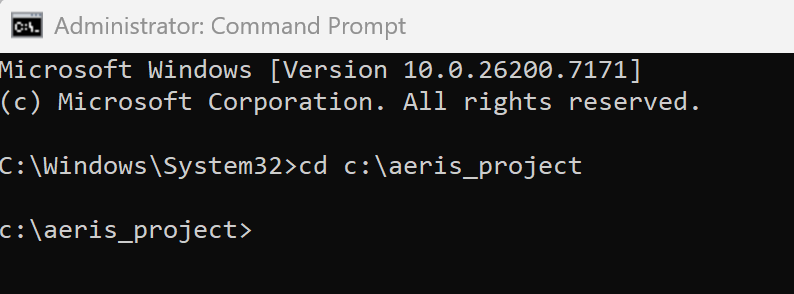

6.  Run the below command to compile the .ino code into a binary

```particle compile photon . --saveTo aerisFirmware.bin```

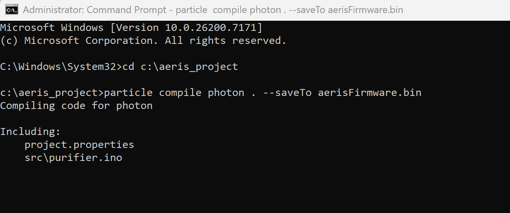

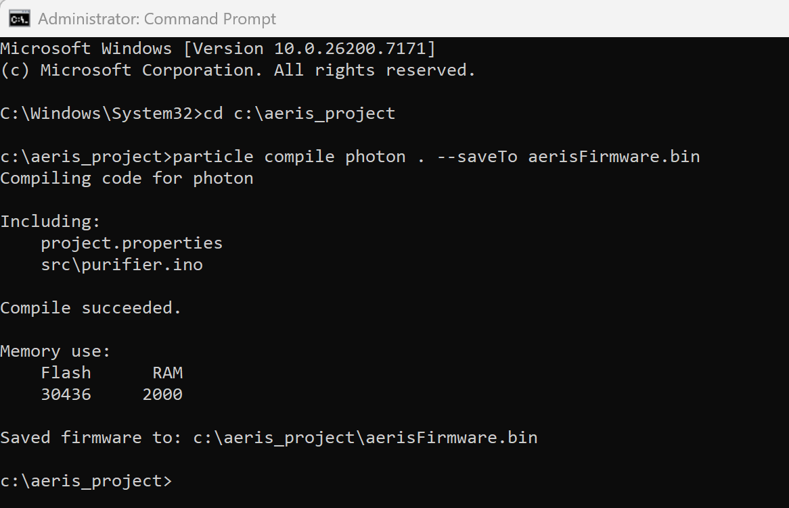

7.  Flash the firmware to your device with:

    ```dfu-util.exe -d 2b04:d006 -a 0 -s 0x080A0000:leave -D aerisFirmware.bin```
